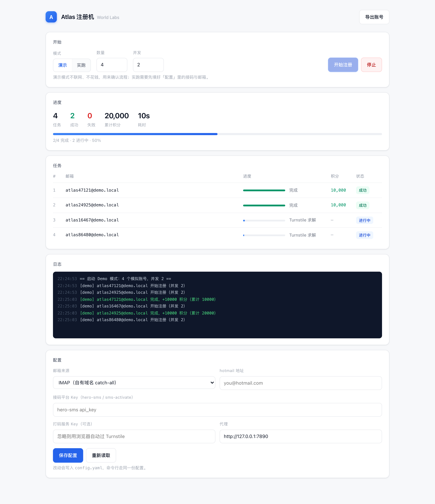

<div align="center">

# Atlas Pool

**One `base_url`. One `key`. Six world-generation models.**

把若干个 World Labs Atlas 账号的额度，聚合成一个 OpenAI 风格的 endpoint。

[](https://www.python.org)
[](https://fastapi.tiangolo.com)
[](LICENSE)
[](#models)
[](docs/API.md)

</div>


---

## What it is

Atlas Pool 由两部分组成，可以分开使用：

| 模块 | 作用 | 入口 |
|---|---|---|
| **Gateway** | 多账号额度池 + OpenAI 风格 API + 极简控制台 | `gateway.py` → `:8790` |
| **Signup** | 从零跑出一个 Atlas 账号：Clerk 注册 → 邮箱码 → 短信码 → 开户 → 自动签发 API Key → 入池 | `webapp.py` → `:8765` |

一个账号 = 10000 积分。网关把这些账号藏在后面，对使用者只暴露 `base_url` + `sk-pool-…`，
按成功率与余额自动轮转，调用全程留痕。

---

## Quick start

```bash
git clone https://github.com/Shamnick/atlas-pool.git && cd atlas-pool
python3 -m venv .venv && ./.venv/bin/pip install -r requirements.txt

# 起网关（首次自动生成一个用户 key 并打印）
./.venv/bin/python gateway.py --port 8790

# 把自己的账号放进池子
./.venv/bin/python gateway.py --port 8790 \
  --seed-account "you@example.com::wl_live_xxxx::10000"
```

第一次调用：

```bash
curl -X POST "http://127.0.0.1:8790/v1/tasks/atlasTextToImage?wait=true" \
  -H "Authorization: Bearer sk-pool-xxxxxxxx" \
  -H "Content-Type: application/json" \
  -d '{"prompt":"a small greenhouse at dawn, warm light, wide view"}'
```

```python
from openai import OpenAI

client = OpenAI(base_url="http://127.0.0.1:8790/v1", api_key="sk-pool-xxxxxxxx")
print([m.id for m in client.models.list().data])
```

```json
{
  "done": true,
  "metadata": { "task": "atlasTextToImage", "state": "SUCCEEDED" },
  "response": {
    "frames": [{
      "imageAsset": { "url": "https://storage.googleapis.com/wlt-marble-outputs-prod/.../asset_..." }
    }]
  }
}
```

---

## Models

全部 6 个任务都在真实账号上端到端跑通过，耗时取自实测。

### 图像

| model | 能力 | 关键参数 | 耗时 |
|---|---|---|---|
| `atlasTextToImage` | 文本 → 场景图 | `prompt` `aspectRatio?` `numSamples?` | 30–41s |
| `atlasGenerate` | 已知位姿/深度上下文 → 生成新视角 | `contextFrames[]` `targetCameras[]` `prompt` | 19s |
| `atlasChisel` | 深度目标帧 + 提示 → 对应视角 | `targetFrames[]` `prompt` | 11s |

### 3D 重建

| model | 能力 | 关键参数 | 耗时 |
|---|---|---|---|
| `images2PosedRGBD` | 图像 → 相机位姿 + 线性深度 | `frames[].imageAsset.assetId` | 6–16s |
| `posedImages2Splats` | 多视图（≥2）→ 3D Gaussian Splats（`.spz`） | `posedFrames[]` | ≈2.7 min |
| `splats2Mesh` | Splats → 三角网格（mesh + anchor） | `splatAsset.assetId` | ≈1 min |

完整字段、链路示例、错误码见 **[docs/API.md](docs/API.md)**。

> 长任务（`posedImages2Splats` / `splats2Mesh`）即使带 `?wait=true` 也会先返回 `RUNNING`，
> 网关会自动轮询 `operations/{id}` 直到 `done`，调用方无感。

---

## API

| Method | Path | 说明 |
|---|---|---|
| `GET` | `/v1/models` | 列出 6 个模型及参数 |
| `POST` | `/v1/tasks/{model}?wait=true` | 提交任务，body 原样透传上游 |
| `GET` | `/v1/operations/{id}?wait=true` | 轮询操作 |
| `GET` | `/v1/usage` | 当前 key 的调用统计 |

鉴权两种写法都接受：

```
Authorization: Bearer sk-pool-xxxxxxxx
WLT-Api-Key:    sk-pool-xxxxxxxx
```

`?wait=true` 阻塞到任务完成（长任务自动轮询，上限 15 分钟）；不带则立即返回 `operation id`。

---

## Console

网关控制台只有三块：**凭证** → **试一下** → **调用记录**。
选模型、写提示词、点运行，图片直接出在图里，3D 产物给下载卡片，JSON 默认折叠。

<div align="center"></div>

注册机控制台同样只有三层：**开始** → **进度** → **任务**，配置收在最后。
「演示」模式不联网不花钱，用来确认流程；「实跑」走真实链路。

---

## How it works

```
                    ┌──────────────────────────────┐
  sk-pool-…  ──────▶│  gateway.py  (:8790)         │
  base_url+/v1      │                              │
                    │  pool:  acct A · B · C …     │
                    │  轮转 · 熔断 · 调用留痕       │
                    └──────────────┬───────────────┘
                                   │ WLT-Api-Key
                                   ▼
                   https://atlas.worldlabs.ai/api/v2
                     POST /tasks:{model}?wait=true
                     GET  /operations/{id}?wait=true
```

每个池内账号持有一个 `WLT-Api-Key`（在 Atlas 后台生成，或由注册机自动签发）。
网关把你的 `sk-pool-…` 换成池内某个账号的 key，并在 `calls` 表里记下 model / 账号 / 状态 / 耗时。

注册一次要经过：

```
Turnstile  →  Clerk signUp(email + phone + password)
           →  email_code（hotmail 登录态读信）
           →  phone_code（hero-sms / sms-activate）
           →  session token
           →  POST /api/v2/users:signUp     ← 后端在此发 10000 积分
           →  签发 WLT-Api-Key              ← 可直接入池
```

---

## Structure

```
atlas-pool/
├── gateway.py            账号池网关
├── webapp.py             注册机面板
├── reg.py                注册机 CLI
├── web/
│   ├── gateway.html      网关控制台
│   └── panel.html        注册机控制台
├── atlasreg/
│   ├── clerk.py          Clerk FAPI 状态机
│   ├── atlas.py          Marble API（开户 / 积分 / API Key）
│   ├── browser.py        浏览器内 SDK 注册
│   ├── owa.py            hotmail 登录态 + 收码
│   ├── mail_ms.py        Microsoft Graph 接码
│   ├── mail.py           IMAP / Email Worker / mail.tm
│   ├── sms.py            接码平台
│   ├── captcha.py        Turnstile 求解
│   ├── pipeline.py       流水线 + 并发
│   └── store.py          SQLite 账号库
├── docs/
│   ├── API.md            模型调用规范（实测）
│   └── RECON.md          逆向记录
└── mailworker.js         Cloudflare Email Worker
```

---

## Notes

- **Chrome required**：注册链路以浏览器为 transport —— Clerk 的 captcha 与页面上下文绑定，
  把真实 token 塞进 HTTP body 仍会 `captcha_missing_token`。网关本身不需要浏览器。
- **一账号一邮箱**：Clerk 会静默丢弃 `user+tag@hotmail.com` 这类 plus 别名（提交成功、邮件不投递）。
- **积分**：`WLT-Api-Key` 只能调任务与操作，读余额要 Clerk JWT（60s 过期）。
  因此积分由注册机落库、控制台「同步积分」刷进池。

<div align="center"><sub>MIT License · built for people who just want the models to work</sub></div>
