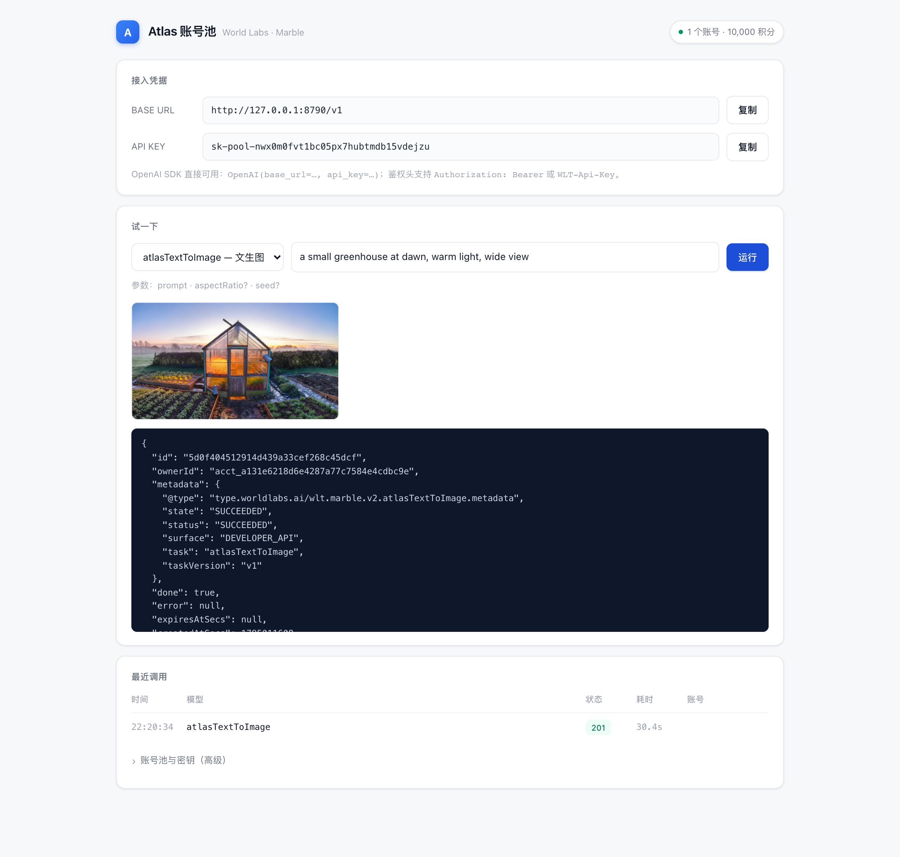

# Atlas Pool

**一个 base_url + 一个 key，调用 World Labs Marble 的四个世界生成模型。**

Atlas Pool 是两层东西：

1. **账号池网关** —— 把若干 Atlas 账号的额度聚合成一个 OpenAI 风格的 endpoint，你只拿 `base_url` + `sk-pool-…`，背后自动轮转账号、记录调用；
2. **注册机** —— 从零把 Atlas 账号跑出来（Clerk 注册 → 邮箱验证码 → 短信验证码 → 开户 → 自动签发 API Key → 自动入池）。



---

## 快速开始

```bash
git clone https://github.com/Shamnick/Atlas.git && cd Atlas
python3 -m venv .venv && ./.venv/bin/pip install -r requirements.txt

# 1) 起网关（首次会自动生成一个用户 key）
./.venv/bin/python gateway.py --port 8790
#    管理面板 → http://127.0.0.1:8790/

# 2) 把自己账号的 WLT-Api-Key 放进池子（面板「添加账号」或 CLI）
./.venv/bin/python gateway.py --port 8790 \
  --seed-account "you@hotmail.com::wl_live_xxxx::10000"
```

第一次调用：

```bash
curl -X POST "http://127.0.0.1:8790/v1/tasks/atlasTextToImage?wait=true" \
  -H "Authorization: Bearer sk-pool-xxxxxxxx" \
  -H "Content-Type: application/json" \
  -d '{"prompt":"a small greenhouse at dawn, warm light, wide view"}'
```

```python
from openai import OpenAI
c = OpenAI(base_url="http://127.0.0.1:8790/v1", api_key="sk-pool-xxxxxxxx")
print([m.id for m in c.models.list().data])
```

返回：

```json
{"done": true,
 "metadata": {"task": "atlasTextToImage", "state": "SUCCEEDED"},
 "response": {"frames": [{"imageAsset": {
   "url": "https://storage.googleapis.com/wlt-marble-outputs-prod/.../asset_..."}}]}}
```

---

## 接口

| 方法 | 路径 | 说明 |
|---|---|---|
| GET | `/v1/models` | 列出可用模型 |
| POST | `/v1/tasks/{model}?wait=true` | 提交任务，body 原样透传上游 |
| GET | `/v1/operations/{id}?wait=true` | 轮询操作 |
| GET | `/v1/usage` | 本 key 的调用统计 |

鉴权支持两种写法：`Authorization: Bearer sk-pool-…` 或 `WLT-Api-Key: sk-pool-…`。

### 四个模型（全部实测通过）

| model | 能力 | 关键输入 | 实测耗时 |
|---|---|---|---|
| `atlasTextToImage` | 文生图 | `prompt` | 32.6s |
| `images2PosedRGBD` | 图 → 相机位姿 + 线性深度 | `frames[].imageAsset.assetId` | 6.1s |
| `atlasGenerate` | 位姿/深度上下文 → 新视角 | `contextFrames[]` + `targetCameras[]` | 19.0s |
| `atlasChisel` | 深度目标帧 → 生成视角 | `targetFrames[]` | 10.7s |

完整的字段级说明、链路示例、错误码在 **[docs/API.md](docs/API.md)**。

---

## 注册机


```bash
./.venv/bin/python webapp.py --port 8765    # → http://127.0.0.1:8765/
```

面板只有三块：开始（模式 / 数量 / 并发）、进度、任务列表；配置折叠在最后。
`演示` 模式不联网不花钱，用来确认流程；`实跑` 走真实链路。

命令行等价：

```bash
./.venv/bin/python reg.py probe                       # 环境自检，打印 Clerk 实例真实配置
./.venv/bin/python reg.py browser --n 1               # 浏览器内 SDK 注册（最稳）
./.venv/bin/python reg.py ms-link --profile ms_profile --email you@hotmail.com --password ***
./.venv/bin/python reg.py run --n 10 --concurrency 2  # 纯 HTTP 批量（需打码 key + 接码 key）
./.venv/bin/python reg.py verify --jwt <jwt>          # 查账号积分
./.venv/bin/python reg.py export --out accounts.csv
```

### 注册一次会经过什么

```
Turnstile(浏览器自动过/人工点一次)
  → Clerk signUp.create(email + phone + password + captchaToken)
  → email_code   （hotmail 登录态读信，正则取 6 位）
  → phone_code   （hero-sms / sms-activate 接码）
  → session token
  → POST /api/v2/users:signUp            ← 后端在此发 10000 积分
  → 签发 WLT-Api-Key                     ← 可以直接入池
  → getPrepaidBalance                    ← 校验到账
```

---

## 目录

```
Atlas/
├── gateway.py            账号池网关（OpenAI 风格 base_url + key）
├── webapp.py             注册机面板
├── reg.py                注册机 CLI
├── web/
│   ├── gateway.html      网关面板
│   └── panel.html        注册机面板
├── atlasreg/
│   ├── clerk.py          Clerk FAPI 状态机
│   ├── atlas.py          Marble API（开户 / 积分 / API Key）
│   ├── browser.py        浏览器内 SDK 注册（含 Turnstile 处理）
│   ├── owa.py            hotmail 登录态 + 收验证码
│   ├── mail_ms.py        Microsoft Graph 接码
│   ├── mail.py           IMAP / HTTP Worker / mail.tm
│   ├── sms.py            接码平台（sms-activate / 5sim）
│   ├── captcha.py        Turnstile（capsolver / yescaptcha / 2captcha / 人工）
│   ├── pipeline.py       6 步流水线 + 并发
│   └── store.py          SQLite 账号库
├── docs/
│   ├── API.md            四个模型的调用规范（实测）
│   └── RECON.md          逆向记录：端点、字段、验证链、踩坑
├── mailworker.js         Cloudflare Email Worker（catch-all 收码）
└── config.example.yaml
```

---

## 环境要求

- Python 3.10+
- Chrome / Chromium（浏览器模式注册与 Turnstile）
- 可选：住宅代理（Turnstile 对机房 IP 判定严格）
- 可选：接码平台 key（Clerk 的手机号是必填 + 需短信验证）

```bash
./.venv/bin/pip install -r requirements.txt
```

---

## 设计取舍

- **为什么用浏览器而不是纯 HTTP**：Clerk 的 captcha 校验与页面上下文（client cookie / Cloudflare `__bm` / nonce）绑定，实测把真实 token 塞进 HTTP body 仍然 `captcha_missing_token`；同一个 token 由页面内 `clerk-js` 提交就通过。所以注册链路以浏览器为 transport，协议交给 SDK。
- **为什么一个账号一个邮箱**：Clerk 会静默丢弃 `user+tag@hotmail.com` 这类 plus 别名（提交成功、邮件永不投递），主地址立刻收到。别名扩充走不通。
- **网关为什么不自己算积分**：`WLT-Api-Key` 只能调任务与操作，读余额要 Clerk JWT（60s 过期）。所以积分由注册机落库、面板「同步积分」刷进池子。

---

MIT License · 见 [LICENSE](LICENSE)
